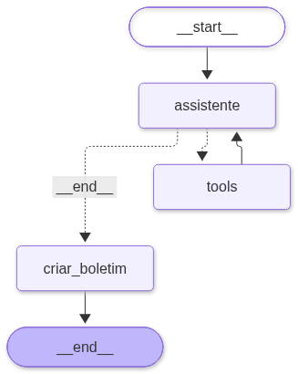

# PoC — Arquitetura do Assistente HealthCare Bot

## Sumário

- [Contexto](#contexto)
- [Pipeline de Processamento de Dados](#pipeline-de-processamento-de-dados)
- [Fluxo Agêntico](#fluxo-agêntico)
  - [Workflow](#workflow)
  - [Ferramentas](#ferramentas)
  - [Boletim Epidemiológico](#boletim-epidemiológico)
- [MLFlow, Monitoramento e Logging](#mlflow-monitoramento-e-logging)
- [Possíveis Extensões](#possíveis-extensões)
- [Conclusão](#conclusão)

## Contexto

## Pipeline de Processamento de Dados

Com base na análise exploratória de dados feita no notebook [eda.ipynb](../eda.ipynb), realizamos primeiramente o download, a limpeza e o processamento dos dados, para que o agente possa, com base neles, criar o Boletim Epidemiológico. Todo o processamento é feito pelo [data_fetching_processing.py](../scripts/data_fetching_processing.py), seguindo os passos:
1. Ele lê, a partir da URL passada, um arquivo `parquet` com os dados (a leitura é feita direto da URL, sem salvar o arquivo bruto). Note que aqui lemos somente as colunas de interesse para a análise, sendo estas:
    - `NU_NOTIFIC`: número de registro sequencial da ficha de notificação, gerado automaticamente pelo sistema. Usamos como identificador do caso, então ele serve como proxy para o número de casos através de um `count`.
    - `DT_SIN_PRI`: data dos primeiros sintomas do caso. É a data de referência das séries temporais (casos diários nos últimos 30 dias, casos mensais nos últimos 12 meses e taxa de crescimento de casos). Preferimos esta à data de notificação (`DT_NOTIFIC`) porque as notificações têm uma periodicidade semanal, com queda no fim de semana por falta de registros, enquanto a data dos sintomas reflete melhor quando o caso de fato ocorreu.
    - `EVOLUCAO`: desfecho do caso (1 - cura, 2 - óbito, 3 - óbito por outras causas, 9 - ignorado). Usamos para calcular a taxa de mortalidade.
    - `VACINA_COV`: indica se o paciente recebeu a vacina contra a COVID-19, conferida na caderneta ou em outra documentação (1 - sim, 2 - não, 9 - ignorado). Usamos para calcular a taxa de vacinação entre os casos.
    - `UTI`: indica se o paciente foi internado em UTI (1 - sim, 2 - não, 9 - ignorado). Usamos para calcular a taxa de ocupação de UTI, isto é, a proporção dos casos que foram internados em UTI.
2. Em seguida, rotulamos e agregamos alguns dados, isto é:
    - Agregamos os óbitos por SRAG e por demais causas (`EVOLUCAO` 2 e 3) como `obito` para simplificar a análise, e rotulamos os demais códigos como texto (`cura`, `vacinado`, `nao_vacinado`, `uti` e `nao_uti`).
    - Rotulamos como nulos os campos ignorados (código 9) na ficha de SRAG do Ministério da Saúde, como, por exemplo, o status da vacinação por COVID-19 e a internação ou não na UTI. O mesmo vale para o código 9 de `EVOLUCAO`, que não está no mapeamento.
3. Com isso, descartamos os registros com nulos em `EVOLUCAO`, `VACINA_COV` ou `UTI`, pois estamos interessados nas taxas de mortalidade, de cobertura vacinal e de internação em UTI.
4. Extraímos então a data de extração (presente no nome do arquivo baixado, e.g. `INFLUD26-19-10-2026.parquet`), a data de criação do dataset (dia de execução do script `data_fetching_processing.py`) e a porcentagem dos dados descartados, e salvamos esses valores como metadados da tabela limpa (`data_extracao`, `data_criacao` e `pct_dados_descartados`). A ideia é que o agente possa extrair essas informações diretamente do dataset para contextualizar a análise. Se o nome do arquivo não seguir esse padrão, a data de extração não é salva e o script registra um aviso no log.
5. Com esses metadados e a tabela limpa, salvamos então os dados em `./data/srag_data_2026_clean.parquet` (ou no caminho passado em `-f`).
6. Por fim, sem relação direta com a análise acima, criamos, a partir da tabela limpa, os gráficos do número diário de casos nos últimos 30 dias e nos últimos 12 meses (365 dias) e os salvamos em `./plots/num_casos_30_dias.png` e `./plots/num_casos_12_meses.png`, respectivamente.

Algumas observações:
- **Viés nos dados mais recentes:** no arquivo analisado no EDA, o descarte dos nulos retira aproximadamente 23% dos registros, e aceitamos essa perda. Ela não é uniforme no tempo: casos recentes ainda sem desfecho (`EVOLUCAO` nulo) na data de extração são descartados, o que tende a subestimar o número de casos dos últimos dias. Provavelmente por isso, e também por atraso de notificação, o valor final da série, que coincide com o último dia do dataset, costuma ser o mínimo.
- **Atualização dos casos:** o dataset é um retrato estático do momento da extração (`data_extracao`), então os números mudam a cada novo arquivo publicado pelo Open DATASUS, pois casos novos são notificados e desfechos de casos antigos são preenchidos depois. Por isso consideramos a data mais recente de primeiros sintomas como o fim da janela de análise (e não a data de execução) e, como usamos só o arquivo de 2026, a janela de 12 meses cobre menos de 12 meses reais. Para atualizar o boletim basta rodar de novo o processamento com a URL do arquivo mais novo.
- **Data de notificação x data dos primeiros sintomas:** comparamos as duas séries temporais de número de casos no EDA. A série por data de notificação tem periodicidade semanal (a transformada de Fourier mostra pico por volta de 7 dias), com queda no fim de semana por falta de notificações, e a correlação das duas séries é moderada. Ao suavizar a série de notificação com uma média móvel semanal centrada, a correlação com a série por primeiros sintomas passa a ser alta. Como as duas passam a carregar a mesma informação, o uso das duas seria redundante e ficamos só com `DT_SIN_PRI`.

## Fluxo Agêntico

### Workflow

<!--  -->

### Ferramentas

### Boletim Epidemiológico

## MLFlow, Monitoramento e Logging

## Possíveis Extensões

## Conclusão
