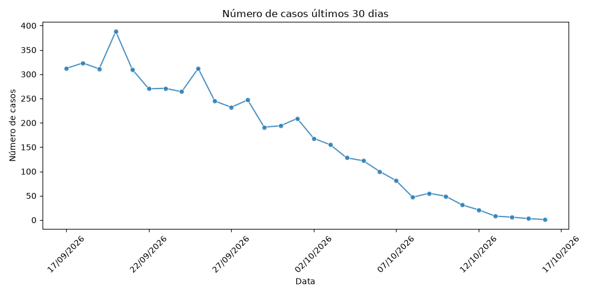
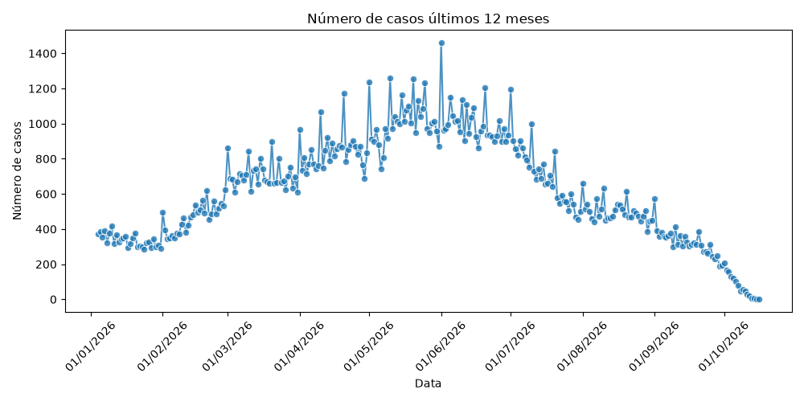

# Boletim Epidemiológico de SRAG

**Indicium HealthCare Inc.** · Período analisado: 04/01/2026 a 16/10/2026

|  |  |
| --- | --- |
| **Elaborado por** | HealthCare Bot (agente de IA) |
| **Destinatário** | Indicium HealthCare Inc. |
| **Data de emissão** | 13/11/2026 |
| **Período analisado** | 04/01/2026 a 16/10/2026 |
| **Fonte dos dados** | Open DATASUS (Sivep-Gripe), extração em 19/10/2026 |

> Documento gerado automaticamente por um agente de IA. Recomenda-se a revisão por um profissional antes do uso em decisões.

## Resumo

O dataset cobre 179.406 casos de SRAG com data de primeiros sintomas entre 04/01/2026 e 16/10/2026. Nos últimos 30 dias foram 5.054 casos (média de 168,47 por dia), e o número diário caiu desde o pico de junho, com a curva dos últimos meses ainda sujeita a atraso de notificação. A mortalidade foi de 6,87% nos últimos 30 dias e de 8,21% nos últimos 12 meses, e a ocupação de UTI foi de 26,14% e 27,29%, respectivamente. Entre os casos, 38,85% estavam vacinados contra COVID-19. As notícias recentes indicam aumento pontual de SRAG em alguns estados, com COVID-19 em nível baixo no país e predomínio de rinovírus e metapneumovírus.

## Sumário

- [Introdução](#introdução)
- [Métodos](#métodos)
  - [Banco de dados](#banco-de-dados)
  - [Confirmação de casos](#confirmação-de-casos)
  - [Coleta e tratamento dos dados](#coleta-e-tratamento-dos-dados)
  - [Análises dos dados](#análises-dos-dados)
- [Resultados e Discussão](#resultados-e-discussão)
  - [Número de casos](#número-de-casos)
    - [Evolução dos casos](#evolução-dos-casos)
    - [Estatísticas](#estatísticas)
    - [Crescimento mensal](#crescimento-mensal)
  - [Demais métricas](#demais-métricas)
- [Últimas notícias sobre SRAG](#últimas-notícias-sobre-srag)
- [Conclusão e recomendações](#conclusão-e-recomendações)
- [Referências bibliográficas](#referências-bibliográficas)

## Introdução

A **Síndrome Respiratória Aguda Grave (SRAG)** é um quadro de síndrome gripal (febre, tosse, dor de garganta, entre outros sintomas) acompanhado de dispneia ou desconforto respiratório, saturação de O2 abaixo de 95% ou cianose, que leva à hospitalização ou ao óbito. Os casos são notificados ao Ministério da Saúde e publicados no Open DATASUS (SIVEP-Gripe). A vigilância da SRAG permite acompanhar a circulação de vírus respiratórios, como influenza e COVID-19, e a pressão sobre o sistema de saúde.

O objetivo deste boletim é apoiar a leitura da situação epidemiológica da SRAG entre 04/01/2026 e 16/10/2026, apresentando a evolução do número de casos, as taxas de vacinação, de mortalidade e de ocupação de UTI, e o contexto trazido pelas notícias mais recentes, com recomendações para a Indicium HealthCare Inc.

## Métodos

Trata-se de estudo epidemiológico descritivo, com base nos registros de casos de SRAG notificados no Brasil entre 04/01/2026 e 16/10/2026.

### Banco de dados

Foi utilizado o Sivep-Gripe (Sistema de Informação da Vigilância Epidemiológica da Gripe), cujos registros de SRAG são publicados no Open DATASUS (conjunto de dados SRAG 2019 a 2026). Como fonte complementar, notícias recentes sobre SRAG foram obtidas por busca na web em domínios institucionais e de imprensa previamente selecionados: Ministério da Saúde, Fiocruz, Agência Brasil e CNN Brasil.

### Confirmação de casos

Para a definição de casos de SRAG, foram considerados os critérios clínicos do Sivep-Gripe: indivíduos hospitalizados por síndrome gripal (SG), ou que evoluíram para óbito independentemente de hospitalização, e que apresentaram pelo menos um dos seguintes sinais de gravidade: dispneia, desconforto respiratório ou saturação de oxigênio inferior a 95%.

### Coleta e tratamento dos dados

Os dados foram extraídos do Open DATASUS em 19/10/2026. Entre as colunas do arquivo, foram selecionadas cinco variáveis:

- "número de notificação" (`NU_NOTIFIC`);
- "data de início dos sintomas" (`DT_SIN_PRI`);
- "evolução do caso" (`EVOLUCAO`);
- "vacina contra covid-19" (`VACINA_COV`);
- "internação em UTI" (`UTI`).

No tratamento, os valores foram rotulados (evolução em cura ou óbito, agrupando o óbito por outras causas com o óbito; vacinação em vacinado ou não vacinado; UTI em sim ou não), e os valores ignorados foram tratados como nulos. Os registros com evolução, vacinação ou internação em UTI nulos foram removidos, o que correspondeu a 22,94% dos registros. Como os casos ainda sem desfecho na data de extração são descartados, o número de casos mais recentes tende a ser subestimado.

### Análises dos dados

Os casos foram contabilizados por data de início dos sintomas. A série por data de notificação apresentou periodicidade semanal e, com média móvel semanal, ficou altamente correlacionada com a série por data de início dos sintomas, de modo que apenas a segunda foi utilizada. As análises consideraram os últimos 30 dias e os últimos 12 meses (365 dias), com as duas janelas terminando na data mais recente de início dos sintomas do dataset.

Para o número de casos, foram calculadas a frequência absoluta diária e, em cada janela, o total, a média, o desvio padrão, o máximo e o mínimo. O crescimento foi medido pela variação percentual do número de casos de cada mês em relação ao mês anterior. As taxas, apresentadas em porcentagem com duas casas decimais, foram calculadas da seguinte forma:

- **Mortalidade:** proporção de óbitos entre os casos com desfecho, nas duas janelas;
- **Ocupação de UTI:** proporção de casos internados em UTI entre o total de casos, nas duas janelas;
- **Vacinação:** proporção de casos vacinados contra covid-19 entre o total de casos de SRAG em todo o dataset, e não a cobertura vacinal da população.

O processamento, o tratamento e as análises foram realizados em Python (pandas, matplotlib e seaborn). A interpretação dos resultados e a redação deste boletim foram feitas por um agente baseado em modelo de linguagem (Claude, da Anthropic), orquestrado com LangGraph, que também consultou as notícias na web.

## Resultados e Discussão

### Número de casos

#### Evolução dos casos

**Últimos 30 dias**

**Últimos 12 meses**

No gráfico de 30 dias, o número diário variou de 1 a 388 casos, com pico em 20/09/2026 (388 casos) e queda até o fim do período. O gráfico de 12 meses mostra subida de janeiro a junho, com máximo de 1.460 casos em 01/06/2026, seguida de queda constante até outubro. O mínimo de 1 caso em 16/10/2026 reflete a última data, incompleta por atraso de notificação, e não uma queda real. Por isso, os últimos dias devem ser lidos com cautela.

#### Estatísticas

| Estatística | Últimos 30 dias | Últimos 12 meses |
| --- | --- | --- |
| Total de casos | 5.054 | 179.406 |
| Média diária de casos | 168,47 | 627,29 |
| Desvio padrão diário | 118,74 | 293,93 |
| Dia com mais casos | 388 (20/09/2026) | 1.460 (01/06/2026) |
| Dia com menos casos | 1 (16/10/2026) | 1 (16/10/2026) |

#### Crescimento mensal

Variação percentual do número de casos de cada mês em relação ao mês anterior.

| Mês | Casos | Crescimento (%) |
|---|---|---|
| 01/2026 | 9.392 | - |
| 02/2026 | 13.118 | 39,67% |
| 03/2026 | 21.859 | 66,63% |
| 04/2026 | 25.239 | 15,46% |
| 05/2026 | 31.436 | 24,55% |
| 06/2026 | 30.071 | -4,34% |
| 07/2026 | 21.928 | -27,08% |
| 08/2026 | 15.465 | -29,47% |
| 09/2026 | 9.714 | -37,19% |
| 10/2026 (parcial, até 16/10) | 1.184 | -87,81% |

> **Nota sobre os dados:** a data mais recente do dataset (16/10/2026) é tratada como o fim das janelas de análise. Os últimos dias e o último mês estão incompletos por atraso de notificação, então a queda observada nesse período não deve ser interpretada como redução real de casos.

Houve alta forte de fevereiro a maio, com pico em maio (31.436 casos), e leve queda em junho (-4,34%). De julho a setembro, a queda foi contínua, de -27,08% a -37,19% ao mês. O mês de janeiro está incompleto, porque o dataset começa em 04/01/2026. O mês de outubro é parcial (até 16/10), por isso a variação de -87,81% não representa uma redução real. Sem esse ajuste, a tendência do período é de queda desde junho.

### Demais métricas

#### Mortalidade e ocupação de UTI

| Métrica | Últimos 30 dias | Últimos 12 meses |
| --- | --- | --- |
| Taxa de mortalidade (óbitos entre os casos com desfecho) | 6,87% | 8,21% |
| Taxa de ocupação de UTI (casos internados em UTI) | 26,14% | 27,29% |

#### Vacinação

| Situação vacinal contra COVID-19 | Casos | Proporção dos casos |
| --- | --- | --- |
| Vacinados | 69.691 | 38,85% |
| Não vacinados | 109.715 | 61,15% |

A taxa de vacinação é a proporção de vacinados entre os casos de SRAG, e não a cobertura vacinal da população.

#### Interpretação

A mortalidade nos últimos 30 dias (6,87%) ficou abaixo da média de 12 meses (8,21%), o que pode refletir o período de menor circulação ou o fato de os desfechos mais recentes ainda estarem em aberto. A ocupação de UTI também ficou levemente abaixo nos últimos 30 dias (26,14%) frente aos 12 meses (27,29%). A proporção de vacinados (38,85%) é a parcela de vacinados entre os casos de SRAG, não a cobertura vacinal da população, e não permite inferir efetividade vacinal sem comparação com o total de não vacinados na população.

## Últimas notícias sobre SRAG

- **Covid-19: pelo menos 5 estados registram aumento de casos graves** (Agência Brasil, 07/11/2026). https://agenciabrasil.ebc.com.br/saude/noticia/2026-11/covid-19-pelo-menos-5-estados-registram-aumento-de-casos-graves. Resumo: com base no InfoGripe da Fiocruz, a reportagem aponta aumento de SRAG em setembro e outubro, com sinais de alta de casos graves de COVID-19 em Mato Grosso, Distrito Federal, São Paulo, Rio de Janeiro e Santa Catarina, em níveis ainda baixos, e cita Roraima, Sergipe e Santa Catarina em alerta sem tendência de crescimento de longo prazo.
- **InfoGripe: três estados têm incidência de SRAG em nível de alerta ou risco, com sinal de crescimento** (Agência Fiocruz de Notícias, 22/10/2026). https://agencia.fiocruz.br/infogripe-tres-estados-tem-incidencia-de-srag-em-nivel-de-alerta-ou-risco-com-sinal-de-crescimento. Resumo: o boletim da semana 41 mostra queda de SRAG na tendência de longo prazo no agregado nacional, com crescimento em Goiás, Mato Grosso e Sergipe; o metapneumovírus e o rinovírus aparecem como principais impulsionadores, e a COVID-19 segue em nível baixo no país.

### Impacto e relação com os dados

As notícias indicam um cenário nacional de queda de SRAG na tendência de longo prazo, em linha com a queda observada no dataset desde junho. Porém, há focos de aumento em alguns estados e capitais, com destaque para COVID-19 em Mato Grosso e sinais de alta de casos graves em São Paulo e Rio de Janeiro. A reportagem de 07/11 fala em aumento de SRAG em setembro e outubro, o que diverge da queda mensal do dataset; essa diferença pode vir de a notícia tratar de incidência regional e de a base local estar incompleta nos meses mais recentes. As métricas deste boletim vêm do dataset, e as notícias apenas contextualizam.

## Conclusão e recomendações

Nos últimos 12 meses, os casos de SRAG subiram de janeiro a maio, atingiram o pico em junho e caíram de forma contínua até outubro, quando o mês ainda está incompleto. A mortalidade (6,87% em 30 dias) e a ocupação de UTI (26,14%) seguem em patamar elevado, e 61,15% dos casos não estavam vacinados contra COVID-19. As notícias indicam queda nacional, mas com focos regionais de aumento, principalmente de COVID-19 e de metapneumovírus, o que exige monitoramento contínuo.

**Recomendações para a Indicium HealthCare Inc.**

1. Manter o monitoramento semanal da curva de casos com correção para o atraso de notificação, já que os últimos dias do dataset estão incompletos e a queda recente pode ser parcialmente artificial.
2. Acompanhar os estados e capitais com sinal de crescimento indicados pela Fiocruz, por exemplo Mato Grosso e Sergipe, já que o dataset agregado pode esconder focos regionais.
3. Dado que a ocupação de UTI está em torno de 26% a 27% e a mortalidade em 6,87% a 8,21%, planejar a capacidade de leitos de UTI e de assistência respiratória para possíveis novas ondas.
4. Reforçar a orientação de vacinação contra COVID-19, pois 61,15% dos casos não estavam vacinados, e monitorar a dose de reforço nos grupos prioritários.
5. Melhorar a qualidade do registro, já que 22,94% dos registros foram descartados por evolução, vacinação ou UTI ignoradas ou nulas.

## Referências bibliográficas

**Fonte dos dados**

- MINISTÉRIO DA SAÚDE. **Open DATASUS: SRAG 2019 a 2026** (SIVEP-Gripe). Disponível em: <https://dadosabertos.saude.gov.br/dataset/srag-2019-a-2026>. Acesso em: 13/11/2026.
- MINISTÉRIO DA SAÚDE. **Open DATASUS: SRAG, dicionário de dados**. Disponível em: <https://dadosabertos.saude.gov.br/dataset/srag-2019-a-2026/resource/3135ac9c-2019-4989-a893-2ed50ebd8e68>. Acesso em: 13/11/2026.

**Referência metodológica**

- BRASIL. Ministério da Saúde. Secretaria de Vigilância em Saúde e Ambiente. **Boletim Epidemiológico**, v. 57, n. 4, 7 ago. 2026: cenário epidemiológico da covid-19, da influenza e de outros vírus respiratórios no Brasil em 2025. Disponível em: <https://www.gov.br/saude/pt-br/centrais-de-conteudo/publicacoes/boletins/epidemiologicos/edicoes/2026/boletim-epidemiologico-volume-57-no-4.pdf/@@download/file>. Acesso em: 13/11/2026.

**Fonte das demais informações**

- Agência Brasil. *Covid-19: pelo menos 5 estados registram aumento de casos graves*. 07/11/2026. https://agenciabrasil.ebc.com.br/saude/noticia/2026-11/covid-19-pelo-menos-5-estados-registram-aumento-de-casos-graves
- Agência Fiocruz de Notícias. *InfoGripe: três estados têm incidência de SRAG em nível de alerta ou risco, com sinal de crescimento*. 22/10/2026. https://agencia.fiocruz.br/infogripe-tres-estados-tem-incidencia-de-srag-em-nivel-de-alerta-ou-risco-com-sinal-de-crescimento
