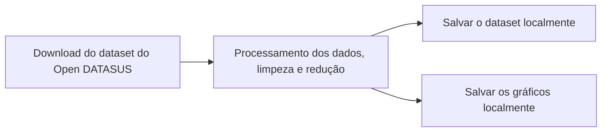
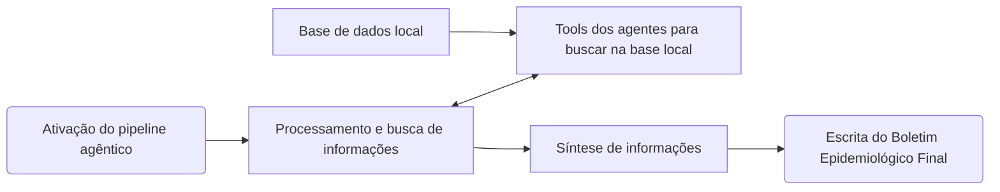

# Planejamento -- Desafio Artificial Intelligence Engineer Certification 2026

Este arquivo contém um planejamento da solução proposta para a resolução do desafio *Artificial Intelligence Engineer Certification* -- Indicium AI 2026.

## Sumário

- [Descrição](#descrição)
  - [Contexto](#contexto)
  - [Descrição dos dados](#descrição-dos-dados)
- [Solução Proposta para a PoC](#solução-proposta-para-a-poc)
  - [Arquitetura](#arquitetura)
  - [Stack Técnica](#stack-técnica)
- [Etapas](#etapas)
  - [1 - Exploração do Dataset e Pipeline de Processamento](#1---exploração-do-dataset-e-pipeline-de-processamento)
  - [2 - Fluxo Agêntico](#2---fluxo-agêntico)
  - [3 - Documentação e Entrega](#3---documentação-e-entrega)

## Descrição

Construir uma solução baseada em Inteligência Artificial Generativa que consiga consultar dados e notícias para gerar relatórios de forma automatizada, trazendo métricas relevantes e as respectivas explicações que ajudem a compreender o cenário atual que as métricas visam medir.

### Contexto

A Indicium HealthCare Inc. está interessada em criar uma solução baseada em dados que possa ajudar profissionais da área da saúde a ter um entendimento em tempo real sobre a severidade e o avanço de surtos de doenças. Para tanto, irá realizar uma Prova de Conceito (Proof of Concept - PoC) para avaliar a viabilidade de tal solução e você foi contratado para ser o analista responsável por desenvolver a solução.

Para a PoC escolheu-se criar uma solução que forneça métricas através de um relatório gerado por um agente que consiga consultar o banco de dados e trazer os valores das métricas. Além disso, usando outras ferramentas, este agente deve consultar notícias sobre Síndrome Respiratória Aguda Grave (SRAG) em tempo real para embasar as métricas apresentadas e fornecer explicações/comentários sobre o cenário relatado. Será utilizado o conjunto real sobre internações por SRAG disponível no Open DATASUS.

As métricas que devem constar no relatório são:
- Taxa de aumento de casos;
- Taxa de mortalidade;
- Taxa de ocupação de UTI;
- Taxa de vacinação da população.

Além das métricas citadas, o relatório deve possuir dois gráficos, um representando o número diário de casos dos últimos 30 dias e outro mostrando o número mensal de casos dos últimos 12 meses.

### Descrição dos dados

Os [dados](https://opendatasus.saude.gov.br/dataset/srag-2021-a-2024), o [dicionário de dados](https://opendatasus.saude.gov.br/dataset/srag-2021-a-2024/resource/3135ac9c-2019-4989-a893-2ed50ebd8e68) e demais informações podem ser obtidos no site do [Open DATASUS](https://opendatasus.saude.gov.br/dataset/srag-2021-a-2024). Os dados estão num arquivo no formato CSV que contém aproximadamente 100 colunas e 165.000 linhas. Por se tratarem de dados reais, temos muitos problemas de preenchimento incorreto e dados ausentes. Por conta disso, você deve selecionar as colunas que achar pertinentes e aplicar os tratamentos que achar necessários.

## Solução Proposta para a PoC

Aqui faremos um resumo da arquitetura proposta, a stack necessária para executá-la e o template básico de boletim epidemiológico final.

### Arquitetura

Nós propomos uma solução totalmente executada localmente via chamadas de API a um modelo de IA comercial; contudo, note que o modelo em si não é o ponto central, pois construiremos uma arquitetura local que permite a troca de modelo se necessário. Aqui dividimos a solução em duas partes: primeiro o download, a limpeza e o processamento dos dados e, então, o uso de um modelo de IA para ler os dados e escrever um boletim epidemiológico com gráficos que sustentem a análise.

Para a primeira parte:
1. Download dos arquivos da base de dados do Open DATASUS.
2. Processamento dos dados em Pandas para a limpeza e redução do dataset a somente o conjunto de dados utilizado.
3. Salvar o dataset em um arquivo local para a consulta da LLM.
4. Salvar os gráficos do número diário de casos dos últimos 30 dias e do número mensal de casos dos últimos 12 meses.

Isso tudo será feito por um script Python, separado do processamento da LLM, utilizando Pandas e Matplotlib. Então a IA lerá os artefatos gerados pela primeira parte por meio de tools dos agentes. Aqui escolhemos não executar o script automaticamente a cada execução da LLM: o usuário o executa sempre que desejar atualizar os dados. Note que, em um cenário de produção, teríamos um pipeline de processamento de dados atualizado periodicamente.

Já para a segunda parte faremos um pipeline agêntico no LangGraph com:
1. Um prompt ativa o modelo passando uma série de informações acerca dos schemas dos dados e da tarefa a ser realizada.
2. O agente usa as tools locais para ler os dados e coleta as informações salvando-as em memória.
3. Estas informações são sintetizadas em um `dict` pelo agente.
4. Com este dicionário preenchemos então uma cópia do template, publicando assim o boletim epidemiológico para o usuário final.

Algumas informações acerca da arquitetura escolhida:
- A LLM é usada para buscar e sintetizar informações na base de dados local, ela não busca nem limpa os dados do Open DATASUS. O motivo de tal escolha é restringir o papel da LLM a tarefas que exijam um processo decisório ou uma análise semântica dos dados, com os passos determinísticos sendo executados no download e na limpeza dos dados via scripts em Python.
- O formato do boletim epidemiológico de saída é um arquivo Markdown com um template fixo salvo no repositório.
- Os gráficos são gerados por meio de um script Python de maneira determinística, garantindo assim a consistência. Contudo, em fases mais avançadas poderíamos fornecer tools ao agente para criar estes gráficos.

Abaixo temos as arquiteturas da primeira e da segunda parte da solução proposta. Para a primeira parte:

Para a segunda parte:

### Stack Técnica

A stack proposta é:

| Ferramenta | Versão | Uso | Motivo |
| --- | --- | --- | --- |
| Python | 3.11 | Linguagem base da solução | Linguagem de uso amplo na indústria e em soluções de IA, facilitando assim a manutenção do produto |
| LangGraph | 1.2.18 | Framework usado para definir os agentes, tools e chamadas da LLM | Solução open source e amplamente utilizada na indústria, contém ferramentas robustas para construirmos fluxos agênticos |
| Matplotlib | 3.11.2 | Geração dos gráficos do boletim epidemiológico | Ferramenta padrão para a geração de gráficos em Python |
| MLflow | 3.17.2 | Monitoramento da solução | Utilizaremos para monitorar as chamadas LLM feitas ao modelo e para um monitoramento geral da solução |
| Pandas | 3.1.0 | Análise estatística | Ferramenta principal usada para a limpeza e transformação dos dados brutos |
| Claude Haiku | 5.5 | LLM | Modelo de IA que fará o processamento das requisições; em um primeiro momento, o Haiku é suficiente para uma PoC, com modelos mais robustos reservados para uma versão em produção |

## Etapas

A seguir detalhamos as etapas para o desenvolvimento do desafio.

### 1 - Exploração do Dataset e Pipeline de Processamento

Nesta etapa focamos na análise exploratória dos dados e no desenvolvimento do pipeline de processamento dos dados. Temos:

- [X] Análise exploratória dos dados via Jupyter notebooks.
- [X] Script de processamento dos dados:
  - [X] Download do dataset.
  - [X] Limpeza dos dados e processamento.
  - [X] Salvar a base de dados processada em disco.
  - [X] Salvar os gráficos dos números diários e mensais.

### 2 - Fluxo Agêntico

Nesta etapa desenvolvemos o fluxo agêntico. Temos:

- [X] Criação do pipeline em LangGraph:
  - [X] Criação do prompt de início de processamento.
  - [X] Criação dos nós necessários.
  - [X] Criação da chamada LLM e configuração da API da Anthropic.
  - [X] Criação dos prompts de processamento e chamada de tools.
  - [X] Criação das tools para leitura da base local de dados.
  - [X] Criação das tools para busca online.
  - [X] Criação das tools para o preenchimento do template em markdown.
  - [X] Criação do dict contendo a síntese do conteúdo.
  - [X] Criação do template em markdown para preenchimento.
- [X] Inserir tracking de MLFlow.
- [X] Criação de Makefile para a execução de cada etapa e limpeza de arquivos.

### 3 - Documentação e Entrega

Finalizamos o planejamento com a documentação e entrega do desafio.

- [X] Escrita da documentação do projeto:
  - [X] Detalhamento do pipeline de processamento dos dados.
  - [X] Detalhamento do fluxo agêntico.
  - [X] Escrever README do projeto.
  - [X] Detalhar Logging e MLFlow.
  - [X] Detalhar possíveis extensões da PoC para um produto final.
  - [X] Renderizar os prompts.
- [ ] Entrega via plataforma da Indicium AI training.
